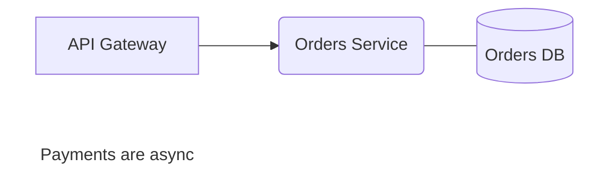

# BlockLiner

BlockLiner is a desktop **diagram editor for software components and architecture**, in the style of Visio: rectangles, rounded rectangles, lines, arrows and text labels that snap to a grid. Each diagram is saved as a **Mermaid flowchart**, so it renders on GitHub, in NoteLiner and anywhere else Mermaid does, and diffs cleanly as text.

It is a pure-Rust desktop app built on [egui](https://github.com/emilk/egui) over the shared `laankit-*` crates — no webview, no JavaScript. The shipped binary is `blockliner`.

- **Run, build, install:** see the [root README](../../README.md).
- **The native app in depth:** see [`native/README.md`](native/README.md).
- **How it fits together:** [`ARCHITECTURE.md`](../../ARCHITECTURE.md).
- **The file format:** see [File format](#file-format) below.

## Features

- **Shapes** — rectangles, rounded rectangles, text boxes, and (under the More Shapes button) diamonds, hexagons, databases, subroutines, stadiums, circles, double circles, parallelograms (leaning either way), trapezoids (wider at the bottom or the top) and asymmetric flags; drag to draw or click for a default size, move and resize on the grid, edit labels in place.
- **Connectors** — straight or right-angle lines and arrows that glue to a shape's sides (fixed) or to the shape (turning as it moves), plus free lines anywhere. Right-angle routes go round shapes in the way, and their middle segment can be dragged. Edge labels ("HTTPS", "reads") are edited in place: double-click the connector or its label.
- **Colours** — fill and stroke from eight preset swatches or any hex value, saved as Mermaid `style` lines, with labels kept readable on the fill. Connectors take a colour too, saved as `linkStyle` lines. Set them from the right-click menu, the palette, or the Properties pane (Ctrl+I), which shows "Mixed" when the selected shapes differ.
- **Copy and paste** — Ctrl+C, Ctrl+X and Ctrl+V, within a diagram, between diagrams and between windows. The clipboard holds Mermaid, so a copy also pastes into a README, and a flowchart copied from elsewhere pastes in laid out; other text pastes as a text box.
- **Editing** — box select, nudge with the arrow keys, undo and redo, single-key tools (V, R, O, D, H, C, S, L, A, J, E, T, or 1–9 in toolbar order), a right-click menu and a command palette (Ctrl+K).
- **A folder of diagrams** — open any folder; its `.mmd` files are the sidebar's diagrams. Changes autosave, and edits made elsewhere (an editor, `git pull`) reload as an undoable step. Close Folder saves and goes back to no folder.
- **Plain Mermaid in** — a flowchart without BlockLiner's layout (pasted from a README, say) is laid out automatically when opened. What BlockLiner doesn't model (subgraphs, styles, other arrow types) is kept as written.
- **Export** — PNG (1×, 2× or 3×) or SVG, all objects or only the selected ones, with or without the grid (Ctrl+Shift+E).

## Data model

A diagram is one Mermaid file (`.mmd`). The folder holds nothing else:

```
<any folder>/
├── Checkout flow.mmd
└── System context.mmd
```

There is no index file and no git integration: the folder is yours to sync however you like. The app's own settings (`ui-preferences.json`: the last folder and diagram, the grid, export options) live in the platform config folder, `~/.config/BlockLiner` on Linux.

## File format

Mermaid flowcharts have no coordinates; Mermaid lays them out itself. To keep the file valid Mermaid while recording exact positions, BlockLiner writes the layout in `%%` comment lines at the end of the file, which Mermaid ignores:



The layout block goes at the end because Mermaid front matter (`---`) must be the first line of the file. The Mermaid part says what each shape is, so `@shape` lines carry only geometry.

### Layout comments

| Comment | Meaning |
|---|---|
| `%% blockliner <version> grid=<px>` | Format version (1) and grid size. |
| `%% @shape <id> x= y= w= h=` | Every shape's rectangle, in model order. |
| `%% @edge <from>-><to>[#n] [from=<anchor>] [to=<anchor>] [route=elbow [mid=x:<n>\|y:<n>]]` | Fixed anchors and the route of the nth edge between two nodes. Written only when an anchor is fixed or the route is right-angle; otherwise the glue is dynamic and the edge straight. Keyed by endpoints, not position, so a hand-inserted edge doesn't shift the others. |
| `%% @line <line\|arrow> from=<end> to=<end> [route=elbow [mid=…]] [stroke=<colour>]` | A connector with at least one free end. An end is `x,y` or `id[:anchor]`. `stroke=` is its colour. |

Any other `%% @…` line is reserved and dropped. Other `%%` comments are kept.

### Mapping to Mermaid

| BlockLiner | Mermaid | Notes |
|---|---|---|
| Rectangle | `id["label"]` | |
| Round rectangle | `id("label")` | |
| Text box | `id["label"]:::bl_text` + `classDef bl_text fill:none,stroke:none` | Renders as bare text in Mermaid. |
| Diamond, hexagon, database, subroutine | `id{"label"}`, `id{{"label"}}`, `id[("label")]`, `id[["label"]]` | Written with the delimiters files already used, so those files don't change. |
| Stadium, circle, parallelogram, trapezoid | `id(["label"])`, `id(("label"))`, `id[/"label"/]`, `id[/"label"\]` | The mirrored `[\ \]` and `[\ /]` stay kept shapes. |
| Any other node shape | Its own delimiters, kept | Drawn as a dashed box with a badge naming the brackets. |
| Glued line | `a --- b` | |
| Glued arrow | `a --> b` | |
| Free line/arrow (either end not glued) | `%% @line …` only | Mermaid can't draw a line that isn't attached to nodes, so it appears in BlockLiner but not in other Mermaid renderers. The status bar shows a hint when the diagram has such lines. |
| Multi-line label | `<br>` inside the quoted label | `"` is escaped as `#quot;`. `#` and `<br` are escaped (`#35;`, `#lt;`) only where they would otherwise be decoded, so `C#` stays `C#`. |
| Edge label | `a -->\|"label"\| b` | Also reads `a -- label --> b`. |
| Shape colours | `style id fill:#dbeafe,stroke:#3b82f6,color:#111827` | One line per styled shape, after the edges. Other properties (`stroke-width`, …) are kept. |
| Edge colours | `linkStyle 2 stroke:#3b82f6` | One line per styled edge, after the `style` lines, numbered among the edges BlockLiner writes (which come first). Other properties are kept. |

New diagrams default to `LR`. A file's own direction is kept. `graph` is written back as `flowchart`.

### Round-trip rules

- **The Mermaid part is the source of truth for what exists.** The comments only add geometry. A comment naming a node that no longer exists (after a hand edit, say) is dropped; a node with no comment gets an automatic position.
- **Statements BlockLiner doesn't model are kept** verbatim and in order: `classDef`, `class`, `style` (except a shape's own), `click`, `linkStyle` (except one naming only modelled edges), other `%%` comments, whole `subgraph … end` blocks, and edges with other link styles (`-.->`, `==>`, `a & b --> c`, …). They are written after the nodes and edges. Nodes declared only inside them are *external*: positioned and drawn (with a lock badge), and movable and resizable, but not relabelled or deleted, because their declaration stays in the kept statement.
- **Writing is deterministic:** nodes in model order, then edges, then kept statements, then the layout block. Shapes are read back in `@shape` order, so a hand-written file is normalised by its first save and is byte-identical from then on. Opening a file writes nothing.
- **Known limitation:** the first save moves modelled edges ahead of kept ones. A hand-written `linkStyle <index>` that names a kept edge (or mixes kept and modelled ones) may then point at a different edge. One naming only modelled edges is read as theirs and renumbered.

### Plain Mermaid

When a file has nodes without `@shape` lines (pasted from a README, or hand edited), they are laid out automatically with a basic layered (Sugiyama-style) layout: nodes are ranked by longest path along the flowchart direction (counting edges inside kept statements too), ordered within each rank by their parents' average position, spaced by cell size and snapped to the grid, and each rank is centred across the widest. Cycles are broken at the edge that closes them. There is no crossing minimisation, so a long edge can cross a box in between; the layout is a starting point to rearrange.
