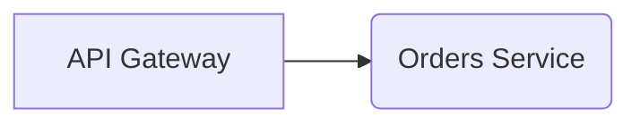

# BlockLiner

BlockLiner is a desktop **diagram editor for software components and
architecture**, in the style of Visio: rectangles, rounded rectangles, lines,
arrows and text labels that snap to a grid. Each diagram is saved as a
**Mermaid flowchart**, so it renders on GitHub, in NoteLiner and anywhere else
Mermaid does, and diffs cleanly as text.

It is a pure-Rust desktop app built on [egui](https://github.com/emilk/egui) over
the shared `marina-*` crates — no webview, no JavaScript. The shipped binary is
`blockliner`.

- **Run, build, install:** see the [root README](../../README.md).
- **The native app in depth:** see [`native/README.md`](native/README.md).
- **How it fits together:** [`ARCHITECTURE.md`](../../ARCHITECTURE.md).
- **The design and its decisions:** [`docs/plans/plan-blockliner.md`](../../docs/plans/plan-blockliner.md).

## Features

- **Shapes** — rectangles, rounded rectangles and text boxes; drag to draw or
  click for a default size, move and resize on the grid, edit labels in place.
- **Connectors** — straight or right-angle lines and arrows that glue to a
  shape's sides (fixed) or to the shape (turning as it moves), plus free
  lines anywhere. Right-angle routes go round shapes in the way, and their
  middle segment can be dragged.
- **Colours** — fill and stroke from eight preset swatches or any hex value,
  saved as Mermaid `style` lines, with labels kept readable on the fill.
- **Editing** — box select, nudge with the arrow keys, undo and redo, single-key
  tools (V, R, O, L, A, J, E, T, or 1–8 in toolbar order), a right-click
  menu and a command palette (Ctrl+K).
- **A folder of diagrams** — open any folder; its `.mmd` files are the sidebar's
  diagrams. Changes autosave, and edits made elsewhere (an editor, `git pull`)
  reload as an undoable step. Close Folder saves and goes back to no folder.
- **Plain Mermaid in** — a flowchart without BlockLiner's layout (pasted from a
  README, say) is laid out automatically when opened. What BlockLiner doesn't
  model (subgraphs, styles, other arrow types) is kept as written.
- **Export** — PNG (1×, 2× or 3×) or SVG, all objects or only the selected ones,
  with or without the grid (Ctrl+Shift+E).

## Data model

A diagram is one Mermaid file. The layout goes in `%%` comments at the end,
which Mermaid ignores:



```
<any folder>/
├── Checkout flow.mmd
└── System context.mmd
```

There is no index file and no git integration: the folder is yours to sync
however you like. The app's own settings (`ui-preferences.json`: the last
folder and diagram, the grid, export options) live in the platform config
folder, `~/.config/BlockLiner` on Linux.
