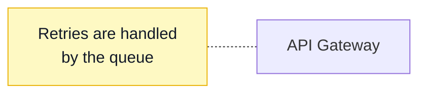

# BlockLiner: Note Shape Plan

Status: implemented (2026-11-06), BlockLiner 2.7.0. Adds a Note shape to BlockLiner: a sticky note, drawn as a pale yellow box with a folded top-right corner, for comments and annotations on a diagram ("Retries are handled by the queue", "TODO: confirm with security").

## Decisions and changes during implementation

- Open questions: (1) the label is centred; (2) Note has its own toolbar button after Text, with N and 0; (3) the same yellow in both themes; (4) the name is "Note".
- Default colours: `Shape::drawn_style()` (`model.rs`) returns the note's style with the yellow fill and stroke filled in where it doesn't set them, and the canvas and the export draw from it. The dark label comes from the existing contrast rule on the yellow fill, so no separate label default was needed.
- Label area: the fold's height is taken off the top and the bottom (not only the top), so a centred label stays centred.
- Properties pane: an unset fill or stroke on a note still shows as "Default", as on other shapes; for a note, Default means its yellow.
- Hit testing is the note's rectangle, including the folded corner.
- Version: bumped to 2.7.0 by hand (`Cargo.toml`, `Cargo.lock`, and the metainfo release), as for 2.4.0.
- Checked by eye: an SVG export rendered to PNG, and the canvas in the light and dark themes (`LAANKIT_SCREENSHOT`).

## Before this change

- A shape's kind is a `ShapeKind` (`crates/blockliner-core/src/model.rs`): Rectangle, Rounded Rectangle, Text, and the twelve More Shapes, plus `Other` for brackets BlockLiner doesn't draw.
- Text is the precedent for a shape Mermaid has no brackets for. It's written as a rectangle with a class, `id["label"]:::bl_text`, plus one `classDef bl_text fill:none,stroke:none` line (`mermaid/write.rs`), and read back as Text when a node has that class (`mermaid/read.rs`, `TEXT_CLASS` in `mermaid/mod.rs`). A node takes one `:::class`, so a Text shape with a class of its own loses that class when saved (recorded in the round-trip tests).
- Mermaid flowcharts have no note shape. Sequence diagrams have notes, but flowcharts don't, and Mermaid 11's expanded shapes (`id@{ shape: ... }`) have no folded-corner note either; BlockLiner's reader doesn't parse that syntax, and older renderers don't draw it.
- A shape's colours come from its `style` line (`Style`) and default to the theme: `bg_surface` fill, `text_secondary` stroke, and `text_primary` label (`canvas/paint.rs`), with matching defaults in the SVG and PNG export (`export.rs`). Reset Style clears the `style` line.
- The preset swatches (`style.rs`) include Yellow: fill `#fef9c3`, stroke `#eab308`. `DARK_TEXT` is `#111827`.
- The toolbar (`views.rs`, `canvas/tools.rs`) has nine buttons, Select, Rectangle, Rounded Rectangle, More Shapes, Line, Arrow, Right-Angle Line, Right-Angle Arrow, and Text, so the number keys 1 to 9 are all taken. The single-key tools use V, R, O, D, H, C, S, L, A, J, E, and T (`commands.rs`); N on its own is free (Ctrl+N is New Diagram), and so is 0 on its own (Ctrl+0 is a zoom command).
- Change Shape offers `ShapeKind::CHANGEABLE` (15 kinds, Text last) in the Properties pane, the right-click menu, and the palette.
- Every shape gets four anchors at its side midpoints, so lines glue to any shape.

## Proposal

### How a note looks

```
+--------------+\
|              | \
|              +--+
|   Retries are   |
|   handled by    |
|   the queue     |
+-----------------+
```

- A rectangle with its top-right corner folded down: the outline cuts the corner diagonally, and a small triangle (the fold) is drawn in a slightly darker shade of the fill, with the stroke along its two inner edges.
- The fold is 16 px at 100% zoom, capped at a quarter of the shape's width and height so a small note still looks right.
- Default colours, used when the note has no `style` of its own: fill `#fef9c3` and stroke `#eab308` (the Yellow preset), and the label `#111827` (`DARK_TEXT`). These are the same in the light and dark themes: a note is yellow in both, so its label must default to dark text rather than the theme's `text_primary`, which is near-white in the dark theme.
- The label is centred, as on every other shape and as Mermaid draws it (see open question 1).
- Default size: 8 × 4 grid cells, a little taller than a box, for two or three lines of text.
- Stroke style, stroke weight, text weight and style, and colours all apply as on other shapes. Reset Style returns a note to yellow, not to the theme's surface colour.

### How it's saved



- Written as a rectangle with the class `bl_note`, and one `classDef bl_note fill:#fef9c3,stroke:#eab308,color:#111827` line when the diagram has at least one note, as Text does with `bl_text`.
- In GitHub, NoteLiner, and any other Mermaid renderer, a note shows as a pale yellow box with dark text. The folded corner appears only in BlockLiner and its exports. This works with every Mermaid version, unlike Mermaid 11's `@{ shape: ... }` syntax.
- A note's own colours are written as a `style id ...` line, as for any shape. Mermaid applies `style` over `classDef`, so a recoloured note looks the same in other renderers.
- On reading, a node with the class `bl_note` becomes a Note, whatever its brackets (as for `bl_text`).
- The `@shape` layout comment is unchanged: `%% @shape note_1 x= y= w= h=`. No format version change.
- As with Text, a note with a class of its own (`:::hot`) loses that class when saved, since a node takes one `:::class`. The round-trip tests record this.
- A `classDef bl_note` written by hand (with other colours) is dropped and replaced, as `classDef bl_text` is today. Colours belong in the note's `style` line.

### Drawing a note

| Where | What |
|---|---|
| Toolbar | A Note button after Text, with a drawn icon (a small folded-corner rectangle), like the other shape tools. Tooltip "Note — N or 0". |
| Keys | N, and 0 as its number key (the tenth button). |
| Palette | "Tool: Note", from the existing tool commands. |
| Change Shape | Note is added to `ShapeKind::CHANGEABLE`, after Text, so any shape can become a note and a note can become any shape. The box, label, colours, and glued lines stay, as for every other change. |

Clicking with the Note tool makes a default-size note and starts editing its label, as the Text tool does; dragging draws one of any size.

Lines glue to a note like any shape (its four side midpoints), so a dotted line from a note to the shape it describes works with no change. Making that line dotted by default is left out (see Out of scope).

### Selecting

- Select Shapes (`Selection::select_shapes`, which today means "everything but text boxes") includes notes.
- Paste of plain text still makes a Text box, not a note.

## Changes

### blockliner-core

| File | Change |
|---|---|
| `model.rs` | `ShapeKind::Note`, named "Note"; delimiters `["`, `"]` (a rectangle); `default_size` 8 × 4; added to `CHANGEABLE` (16 kinds) after Text. |
| `mermaid/mod.rs` | `NOTE_CLASS = "bl_note"` and the `classDef` line's properties as a constant, beside `TEXT_CLASS`. |
| `mermaid/write.rs` | `node()` writes `id["label"]:::bl_note` for a note; the `classDef bl_note` line is written after `classDef bl_text` when any note exists. |
| `mermaid/read.rs` | A node with class `bl_note` becomes `ShapeKind::Note`, as for `bl_text`. A `classDef bl_note` statement is dropped rather than kept as passthrough (check how `classDef bl_text` is handled today and match it). |
| `geometry.rs` | `NOTE_FOLD` (16 px), `note_fold(r)` (the capped size), `polygon` and `outline_path` for Note (five points, corner cut), and a `note_fold_triangle(r)` helper for the fold. `label_rect` is the shape's rectangle less the fold's height at the top and the bottom, so a long label doesn't run into the fold and stays centred. Anchors and hit testing are unchanged (side midpoints, the rectangle). |
| `style.rs` | `NOTE_FILL`, `NOTE_STROKE` constants (the Yellow preset's values) and a `Style` helper that returns a shape's default fill, stroke, and label colour by kind, so painting and export share one rule. |

### blockliner-native

| File | Change |
|---|---|
| `canvas/tools.rs` | `Tool::Note`, after `Tool::Text` in `Tool::ALL`; `shape_kind` maps it to `ShapeKind::Note`; `slot` gives it 9. Click-to-place starts label editing, as for Text. |
| `commands.rs` | Key N for `Tool::Note`; number key 0 (`Key::Num0`) for slot 9. Check that plain 0 doesn't collide with the Ctrl+0 zoom binding (it's a different modifier, so it shouldn't). |
| `views.rs` | The toolbar button, and `paint_tool_icon` draws the folded-corner icon. |
| `canvas/paint.rs` | Note: the cut-corner polygon in the note's fill and stroke, then the fold triangle in the fill darkened by about 8%, then the fold's two inner edges in the stroke. Defaults from the new `style.rs` helper, including the dark label. Dashed and dotted strokes go through the existing `outline_path` pass. |
| `export.rs` | The same in SVG (a `<polygon>` for the body and one for the fold) and so in PNG. Default label colour from the shared helper. |
| `properties.rs` | The summary line says "Note “…”". The Fill and Stroke rows show the note's yellow as its default (check what the pane shows for an unset fill today and match it). |

### Docs

| File | Change |
|---|---|
| `apps/blockliner/README.md` | Notes in Features; a Note row in Mapping to Mermaid (`id["label"]:::bl_note` + `classDef bl_note ...`, "a yellow box in Mermaid; the folded corner is BlockLiner's own"); N and 0 in the key list; the file format example gains a note. |
| `apps/blockliner/native/README.md` | The toolbar and keys, if listed there. |
| `ARCHITECTURE.md` | Only if it lists the shape kinds. |

Version: BlockLiner 2.7.0 (a new feature), with `scripts/set-version.sh blockliner 2.7.0` once per-app versions land (APT plan, phase 2), or by hand as for 2.4.0.

## Tests

| Where | Test |
|---|---|
| `blockliner-core/tests/mermaid.rs` | Round trip: a note with a label, colours, and a glued line is written as `:::bl_note` with one `classDef`, and reads back as the same diagram. No `classDef bl_note` when there are no notes. A hand-written `classDef bl_note` is replaced. A note with its own class loses it (recorded, as for Text). Add Note to the random round-trip generator's kinds. |
| `geometry.rs` | The fold is capped on a small note; the polygon has five points; anchors are the side midpoints; `label_rect` sits below the fold. |
| `model.rs` | `CHANGEABLE` has 16 kinds and ends Text, Note. |
| `ui_tests_note.rs` (new) | N and 0 select the Note tool; clicking places an 8 × 4 note and starts editing; typing and Escape keep the label; Change Shape turns a rectangle into a note and back with its label, colours, and lines kept; Reset Style returns a recoloured note to yellow; Select Shapes includes notes; undo removes a placed note in one step. |
| `ui_tests_export.rs` | An SVG export of a note contains the body polygon, the fold, and `#fef9c3`; a note's label is dark in a dark-theme export. |
| `ui_tests_change_shape.rs` | Update the expected list length and order. |

## Out of scope

- Left-aligned or top-aligned note text. All labels are centred today, as Mermaid draws them; alignment would be a separate feature for every shape.
- A dotted line by default when a line starts or ends at a note.
- Other note colours as presets (pink, blue, green notes); the existing Fill swatches already recolour a note.
- Keeping a note's own class (`:::hot`) by writing `class id bl_note` statements instead of `:::bl_note`. That would fix the one-class limit for Text too, so it belongs in its own change.
- Mermaid 11's `@{ shape: ... }` syntax.

## Open questions

1. Label alignment: centred (as proposed, matching Mermaid and the other shapes), or top-left like a real sticky note, accepting that other Mermaid renderers will still centre it?
2. Toolbar: a button of its own after Text (as proposed, with N and 0), or one of the More Shapes (no new button, no number key, and the number keys stay 1 to 9)?
3. Colour in the dark theme: the same pale yellow as in the light theme (as proposed), or a muted dark-theme yellow? The saved file can only hold one, so the dark variant would apply in BlockLiner only.
4. Name in the UI: "Note" (as proposed) or "Sticky Note"?
