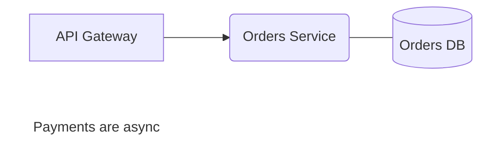

# BlockLiner — Architecture Diagramming App

Status: **In progress (2026-10-29).** Design decisions settled (§9). Phases 0
(app scaffold), 1 (`crates/blockliner-core`), 2 (shapes), 3 (connectors) and 4
(undo and keyboard) implemented.

A fourth marina app: a Visio-style canvas for software component and
architecture diagrams, where every diagram is saved as a **Mermaid** file.
You draw boxes and connectors by hand on a snapping grid. The file stays plain
Mermaid, so it renders on GitHub/GitLab, diffs in git, and can be pasted into
a NoteLiner note.

---

## 1. Name

**BlockLiner** (decided 2026-10-29). It has the `-Liner` suffix (NoteLiner,
ThreadLiner, PageLiner). Architecture diagrams are mostly component blocks
joined by lines, and Mermaid has a `block` diagram type the app could grow
into.

The app was first scaffolded as *ChartLiner* (a nautical chart as the map of
a system). It was renamed before any release, because "chart" suggests bar
and line charts. Nothing outside the repo used the old name.

| Name | Emphasis | Note |
|------|----------|------|
| **BlockLiner** | Component blocks | Chosen. |
| **BoxLiner** | "Boxes and lines" sketches | Friendly, but informal and less clearly about software. |
| **DraftLiner** | Drafting (and a ship's *draft*) | "Draft" also reads as "unfinished document". |
| **ChartLiner** | The map of a system | The first name; "chart" suggests data charts. |

The app is `blockliner` (binary and crates `blockliner-core` /
`blockliner-native`), app id `com.blockliner.app` (the same pattern as
`com.pageliner.app`), and product folder `BlockLiner`. The Mermaid class for
text boxes is `bl_text`.

---

## 2. Scope

### MVP (this plan)

- **Shapes:** rectangle and round rectangle, each with a centred label.
- **Lines:** plain line and line with an arrowhead. An endpoint can **glue**
  to a shape's anchor (side midpoints) and follows the shape when it moves.
  An endpoint can also be left free on the grid.
- **Text boxes:** free-standing labels with no border.
- **Grid snapping:** positions, sizes and free line endpoints snap to the grid
  (default 20 px; 10/20/40 in Settings). Hold `Alt` to place freely. The grid
  is drawn and can be hidden.
- **Editing:** select (click, `Shift`+click, marquee), move, resize handles,
  delete, double-click to edit a label inline, undo/redo, pan (`Space`+drag
  or middle mouse) and zoom (`Ctrl`+wheel).
- **Files:** a project is a plain folder of `.mmd` files. Edits autosave
  (debounced). BlockLiner does **no git syncing**. If the folder happens to be
  a git repo, the user commits it with their own tools.
- **Mermaid round-trip:** BlockLiner reads back what it writes, exactly
  (§4). It also imports a hand-written flowchart that has no layout data and
  lays it out automatically (§4.4).

### Not in the MVP (later phases, §7)

Orthogonal/elbow routing, edge labels, colours/styles, `subgraph` containers
(boundaries), copy/paste and duplicate, alignment/distribute, SVG/PNG export,
a stencil library (database, queue, actor, cloud), multiple pages, and
Mermaid diagram types other than `flowchart`.

---

## 3. Architecture

BlockLiner follows the same layering as the other apps (`ARCHITECTURE.md`):

```
apps/blockliner/native      eframe app: canvas widget, tools, sidebar, overlays,
                            tokio backend (file IO, autosave)
crates/blockliner-core      document model, Mermaid read/write, geometry,
                            snapping, hit-testing, undo history: no egui
crates/marina-core          paths, json, debounce (unchanged; git unused)
crates/marina-egui          theme, toolbar, palette, settings, panes (unchanged)
```

### 3.1 `crates/blockliner-core` (new, no egui dependency)

| Module | Responsibility |
|---|---|
| `model` ✅ | `Diagram { direction, grid, shapes: Vec<Shape>, connectors: Vec<Connector>, preamble, passthrough }`. `Shape { id, kind: Rect \| RoundRect \| Text \| Other{open, close}, label, rect, class, external }`. `Connector { kind: Line \| Arrow, from: End, to: End, label }`. `End` is `Glued { shape, anchor: Option<N\|E\|S\|W> }` (`None` = dynamic glue, the nearest side) or `Free(Point)`. Its own `Point`/`Rect` types (f32), so it needs no egui. |
| `mermaid::write` ✅ | `Diagram` → `.mmd` text. Deterministic order (stable diffs). |
| `mermaid::read` ✅ | `.mmd` text → `Diagram`. A small hand-written lexer and reader for the `flowchart` subset in §4. Unknown statements are kept verbatim and written back. |
| `layout` ✅ (placeholder) | Positions for nodes without `@shape`. Phase 1 places them in a simple row-by-row grid; phase 6 replaces this with the layered layout (§4.4). |
| `geometry` ✅ | Rectangle helpers, resize handles and maths, shape hit-testing, marquee containment. |
| `connect` ✅ | Anchor positions, connector end resolution (fixed and dynamic glue), distance-to-segment, connector and anchor hit-testing, `glue_at`, removing connectors. |
| `snap` ✅ | `snap(v, grid)`, `snap_point`. |
| `history` ✅ | Undo/redo as whole `Diagram` snapshots (200 kept). The app calls `observe` whenever the canvas is idle, so each finished change is one step without per-edit bookkeeping. Diagrams are small, so snapshots are simpler than an operation log and cannot get out of sync. |
| `ids` ✅ | Readable Mermaid node ids from labels (`"Orders DB"` → `orders_db`, de-duplicated). |

Everything in the core is unit-tested without a window.

### 3.2 `apps/blockliner/native` (new)

Same file layout as `apps/pageliner/native`:

| File | Contents |
|---|---|
| `main.rs` | Viewport (title, `APP_ID`, icon, custom title bar), `persistence_path`. Copy of PageLiner's. |
| `config.rs` | `Paths` / `Prefs` in `~/.config/BlockLiner/ui-preferences.json`: `customTitlebar`, `sidebarVisible`, `statusBarVisible`, `gridSize`, `showGrid`, `lastProject`. |
| `commands.rs` | `Act` enum + `Registry`: tool selection (`V` select, `R` rect, `O` round rect, `L` line, `A` arrow, `T` text), undo/redo, delete, zoom, toggle grid, new/rename/delete diagram, open project, settings, palette. |
| `backend.rs` | Tokio runtime: list/read/write `.mmd` files, debounced autosave through `marina_core::debounce`, atomic writes. Request/`Event` channels, the same as ThreadLiner/PageLiner. |
| `app.rs` | `BlockLinerApp`: owns backend, open diagram, `EditorState`, overlays, palette, toasts. Routes events, commands and canvas actions. |
| `canvas/view.rs`, `canvas/grid.rs` ✅ | Pan/zoom transform (zoom steps 10–600 %, zoom about a point) and the grid (minor lines, a major line every 5 cells, only majors when cells get small). |
| `canvas/mod.rs` ✅ | The canvas widget: `ui.allocate_painter`, view transform (pan + zoom), grid drawing, item painting, input dispatch to the active tool. Returns `CanvasAction`s (`Changed`, `SelectionChanged`, `EditLabel(id)`). |
| `canvas/tools.rs` ✅ | A small state machine per tool: `Idle → Dragging{start} → commit`. Rect tools snap the start and end corners. Line tools show anchor hints on hover and glue when released over one. |
| `canvas/paint.rs` ✅ | Draws shapes, connectors, arrowheads, selection handles and anchor hints with theme colours from `marina_egui::theme`. |
| `canvas/label.rs` ✅ | Inline label editing: an `egui::TextEdit` placed over the shape (multi-line, `Enter` commits, `Shift+Enter` adds a line, `Esc` cancels). |
| `views.rs` | Sidebar (diagram list for the project), toolbar (`marina_egui::toolbar` with tool buttons), status bar (zoom %, grid size, cursor position in grid units, save state). |
| `overlays/` | Settings (grid size, show grid, title bar), rename/delete confirmations, About. |
| `ui_tests.rs` | `egui_kittest` headless flows (§6). |

**Zoom keys.** Unlike the other apps, Ctrl+= / Ctrl+- / Ctrl+0 and
Ctrl+wheel zoom the *canvas*, as in other drawing tools. The UI scale stays in
Settings and the custom title bar. Plain wheel/trackpad scrolling, a middle
drag or Space+drag pan. The grid toggles with Ctrl+'.

**Rendering coordinates.** The model is stored in *diagram pixels at 100 %
zoom*. The canvas maps model → screen with `screen = origin + (p - pan) *
zoom`. Snapping always happens in model space, so zoom never changes where
an item lands.

---

## 4. File format: Mermaid with layout comments

Mermaid flowcharts have no coordinates, and Mermaid lays them out itself. To
keep the file valid Mermaid while recording exact positions, BlockLiner writes
the layout in `%%` comment lines. Mermaid ignores these lines.

### 4.1 Example



The BlockLiner block goes **at the end** because Mermaid front matter (`---`)
must be the first line of the file. The Mermaid part says what each shape is,
so `@shape` lines carry only geometry. `orders_db` uses a cylinder, which the
MVP can't draw. It keeps its delimiters (`ShapeKind::Other`), is drawn as a
rectangle, and is written back unchanged.

| Comment | Meaning |
|---|---|
| `%% blockliner <version> grid=<px>` | Format version (1) and grid size. |
| `%% @shape <id> x= y= w= h=` | Every shape's rectangle, in model order. |
| `%% @edge <from>-><to>[#n] [from=<anchor>] [to=<anchor>]` | Fixed anchors of the nth edge between two nodes. Written only when an anchor is fixed; otherwise the glue is dynamic. Keyed by endpoints, not position, so a hand-inserted edge doesn't shift the others. |
| `%% @line <line\|arrow> from=<end> to=<end>` | A connector with at least one free end. An end is `x,y` or `id[:anchor]`. |

Any other `%% @…` line is reserved and dropped. Other `%%` comments are kept.

### 4.2 Mapping

| BlockLiner | Mermaid | Notes |
|---|---|---|
| Rectangle | `id["label"]` | |
| Round rectangle | `id("label")` | |
| Text box | `id["label"]:::bl_text` + `classDef bl_text fill:none,stroke:none` | Renders as bare text in Mermaid. |
| Glued line | `a --- b` | |
| Glued arrow | `a --> b` | |
| Free line/arrow (either end not glued) | `%% @line …` only | Mermaid cannot draw a line that is not attached to nodes. The line appears in BlockLiner but not in other Mermaid renderers. The status bar shows a hint when the diagram has such lines. |
| Multi-line label | `<br>` inside the quoted label | `"` is escaped as `#quot;`. `#` and `<br` are escaped (`#35;`, `#lt;`) only where they would otherwise be decoded, so `C#` stays `C#`. |
| Edge label (read and kept; editing comes after the MVP) | `a -->\|"label"\| b` | Also reads `a -- label --> b`. |

New diagrams default to `LR`. A file's own direction is kept. `graph` is
written back as `flowchart`.

### 4.3 Round-trip rules

- **The Mermaid part is the source of truth for what exists.** The comments
  only add geometry. If a comment names a node that no longer exists (for
  example after a hand edit), BlockLiner drops it. A node with no comment
  gets an automatic position.
- **Statements BlockLiner doesn't model are kept** verbatim and in order:
  `classDef`, `class`, `style`, `click`, `linkStyle`, other `%%` comments,
  whole `subgraph … end` blocks, and edges with other link styles (`-.->`,
  `==>`, `a & b --> c`, …). They are written after the nodes and edges. Nodes
  that are declared only inside them are marked `external`. Those nodes are
  positioned and drawn, but not editable, because their declaration stays in
  the kept statement.
- **Writing is deterministic:** nodes in model order, then edges, then kept
  statements, then the layout block. Shapes are read back in `@shape` order,
  so a hand-written file is normalised by its first save and is
  byte-identical from then on (`tests/fixtures/handwritten*.mmd`).
- **Known limitation:** the first save moves modelled edges ahead of kept
  ones. A hand-written `linkStyle <index>` that mixes the two may then point
  at a different edge.
- Tested by golden files for both directions and a round trip over 2,000
  generated diagrams (`read(write(d)) == d`, and `write` is idempotent).

### 4.4 Importing plain Mermaid

When a file has nodes without `@shape` lines (pasted from a README, or hand
edited), `layout::layered` places them:

1. Find the longest-path rank of each node from the edges, following the
   flowchart direction.
2. Within each rank, order the nodes by the average position of their
   parents. One pass is enough for MVP-sized diagrams.
3. Space ranks and slots by cell size, snapped to the grid.

This is a basic Sugiyama-style layout without crossing minimisation. That is
good enough for a starting point the user then rearranges, and the result is
saved on the first edit.

---

## 5. Interaction details

- **Creating:** with a shape tool, drag from corner to corner. A plain click
  creates a default-size shape (8×3 grid cells), which is faster for
  architecture diagrams. The new shape starts in label-edit mode. After one
  shape the tool returns to Select (Visio's behaviour). Holding `Shift`
  while choosing a tool keeps it active.
- **Connecting:** with a line/arrow tool, hovering a shape shows its 4
  anchors. Pressing on an anchor or a shape body glues the start. Releasing
  over a shape glues to the nearest anchor, otherwise to the snapped grid
  point. A selected connector shows endpoint handles, which can be dragged
  to re-glue or un-glue.
- **Glue:** dropping a line end within 8 screen points of a side midpoint
  glues it there (a fixed anchor, written as `@edge … from=E`). Dropping it
  elsewhere on a shape glues it *dynamically*: it uses whichever side
  midpoint is nearest the other end, so it turns as shapes move, and needs
  no `@edge` line. A line can't join a shape to itself. The shape a line end
  would glue to shows its four anchors while drawing or dragging, with the
  chosen one filled, or the shape outlined for dynamic glue.
- **Lines** are selected by clicking within 5 screen points, box-selected
  when both ends are inside, and deleted with Delete. Dragging a line moves
  its free ends only; glued ends stay with their shapes. A single selected
  line shows its two ends as handles (filled when glued), and dragging one
  re-glues or frees it. Edge labels read from a file are drawn at the
  midpoint, read-only.
- **Moving:** a drag moves the selection by whole grid steps. The delta is
  snapped, not each item's position, so items that are not on the grid
  (after `Alt` placement) keep their offset. Glued connectors follow.
- **Resizing:** 8 handles. Edges snap to the grid. The minimum size is one
  grid cell.
- **Ids:** a new shape takes its Mermaid id from its first label
  (`"Orders DB"` → `orders_db`); after that the id stays put when the label
  changes. An empty first label leaves `node`, `node_2`, ….
- **Deleting** a shape also deletes the connectors glued to it, since a
  Mermaid edge can't have a missing end. Shapes declared only in kept
  statements (`external`) can be moved and resized but not relabelled or
  deleted.
- **Esc** cancels a label edit, else a drag (moved or resized shapes go
  back), else clears the selection.
- **Undo:** one history entry per finished change. The history is taken
  whenever the canvas is idle (no drag, no label being edited), so a whole
  drag is one entry, and so is creating a shape together with its first
  label. `Ctrl+Z` undoes, and `Ctrl+Shift+Z` / `Ctrl+Y` redo. A new change
  after an undo drops the redo trail. Undo during a drag cancels the drag
  first. While a label is being edited, `Ctrl+Z` belongs to the text field.
- **Keyboard:** arrow keys nudge the selection by one grid step (`Shift`: 5
  steps, `Alt`: 1 px), moving the free ends of selected lines too.
  `Delete`/`Backspace` deletes. `Ctrl+A` selects all shapes and lines. `Esc`
  cancels a label edit or gesture, else clears the selection.

---

## 6. Testing

- **Core (`cargo test -p blockliner-core`):** parser and writer golden files
  under `crates/blockliner-core/tests/fixtures/` (written by BlockLiner,
  hand-written Mermaid, and files with passthrough lines); round-trip
  property tests; snap, anchor and hit-test unit tests; layout tests
  (no overlap, ranks increase in the flow direction); history coalescing.
- **UI (`egui_kittest`, headless, as in the other apps):**
  - pick Rect tool → drag → a shape exists at the snapped rect → the label
    typed in is in the saved `.mmd`;
  - draw an arrow between two shapes → `a --> b` written → moving a shape
    keeps the connector glued;
  - undo/redo across create, move and delete;
  - `Alt` placement off the grid; grid size change in Settings;
  - opening a hand-written fixture shows the auto-laid-out nodes, and saving
    keeps the passthrough lines.
- **Screenshots** for visual checks are rendered offscreen with
  `egui_kittest` + wgpu (`MARINA_SCREENSHOT`-style), never in a real window.

---

## 7. Phases

| Phase | Deliverable | Effort |
|---|---|---|
| **0. Scaffold** ✅ | `blockliner-core` + `apps/blockliner/native` crates in the workspace; window opens with toolbar, empty canvas, grid, pan/zoom; icon (`assets/icon.svg/png`); `config.rs` paths. | 1 day |
| **1. Core model + Mermaid** ✅ | `model`, `mermaid::read/write`, `ids`, layout comments, passthrough, golden + round-trip tests. Can be built in parallel with phase 0. | 2–3 days |
| **2. Shapes** ✅ | Select, Rect, RoundRect, Text tools; snap; move; resize handles; marquee; delete; inline label editing; painting with theme colours. | 3–4 days |
| **3. Connectors** ✅ | Line/Arrow tools, anchors, glue/unglue, endpoint handles, arrowheads, hit-testing on segments, free lines. | 2–3 days |
| **4. History + keyboard** ✅ | Snapshot undo/redo with gesture coalescing; nudge; select all; command registry and palette entries. | 1 day |
| **5. Project + persistence** | Backend: open folder, diagram list sidebar, new/rename/delete, debounced atomic autosave, external-change reload; `lastProject`. | 2 days |
| **6. Import layout** | `layout::layered` for nodes without positions; "not editable" badge for unsupported node shapes. | 1–2 days |
| **7. Ship** | Packaging and CI (§8), README, `ARCHITECTURE.md`, kittest flows, hand checks on Linux/Windows/macOS. | 1–2 days |

**MVP total: about 2.5–3 weeks.**

### After the MVP (in rough value order)

1. **SVG/PNG export** of the canvas as drawn (exact layout, unlike Mermaid's).
2. **Edge labels** (`a -- "HTTPS" --> b`) and **orthogonal routing**.
3. **Subgraphs as boundary containers** (system/trust boundaries), which
   architecture diagrams use a lot. Maps to Mermaid `subgraph`.
4. Copy/paste, duplicate, align/distribute, z-order.
5. Styles (fill/stroke colour → `style`/`classDef`) and more shapes
   (`[( )]` database, `[[ ]]` subroutine, `{{ }}` hexagon).
6. "Copy as Mermaid" and opening `.mmd` files from NoteLiner.

---

## 8. Repo touchpoints

Adding a fourth app touches these places outside the new crates:

- `Cargo.toml`: add `crates/blockliner-core` (covered by `crates/*`) and
  `apps/blockliner/native` to `members`; add `blockliner-core` to
  `[workspace.dependencies]`.
- `apps/blockliner/native/Cargo.toml`: copy PageLiner's packaging metadata
  (`deb`, `generate-rpm`, `packager`) with the new names, binary
  `blockliner`, `rfd = "0.15"` for the folder picker.
- `apps/blockliner/native/build.rs`: Windows icon, copied.
- Package `depends`/`requires`: as PageLiner's **minus `git`**, which
  BlockLiner never runs.
- `packaging/linux/com.blockliner.app.{desktop,metainfo.xml,appimage.desktop.hbs}`,
  `packaging/flatpak/com.blockliner.app.yml`. The desktop file registers
  `text/vnd.mermaid` / `*.mmd` as a MIME type it can open.
- `xtask/src/main.rs`: add `("blockliner", "com.blockliner.app")` to the
  icon list.
- `scripts/package-native.sh` (`ALL_APPS`) and `scripts/set-version.sh`
  (`APPS`).
- `.github/workflows/build.yml`: add `-p blockliner-core -p blockliner-native`
  to the clippy and test lines. (`release-native.yml` does not list apps by
  name. It goes through `package-native.sh`.)
- `README.md` (apps table, layout) and `ARCHITECTURE.md` ("three apps" →
  four, app cores list).
- `apps/blockliner/README.md` and `apps/blockliner/native/README.md`.

---

## 9. Decisions and open questions

| # | Question | Recommendation |
|---|---|---|
| 1 | File is Mermaid + layout comments, or a JSON model with Mermaid export? | **Decided: Mermaid + comments.** It matches the request ("using Mermaid"), there is one file per diagram, it renders on GitHub, and it diffs well. The cost is the free-line limitation in §4.2. |
| 2 | Free lines not attached to shapes: keep them (BlockLiner-only) or disallow them? | **Decided: allowed**, with the status-bar hint. |
| 3 | Project = folder of `.mmd` files (NoteLiner-like), or open/save single files? | **Decided: a plain folder, no git syncing.** Single-file "Open…" can be added cheaply later. |
| 4 | Render Mermaid's own layout in-app as a "preview" tab? | No. There is no pure-Rust Mermaid renderer, and this app has no webview. The canvas is the view. |
| 5 | Reuse `noteliner-slides`' colour/theme helpers? | Only `marina_egui::theme` for MVP. Shape styles come later. |
| 6 | Should canvas primitives move to a shared crate (`marina-canvas`)? | Not yet. Extract them only if NoteLiner slides or a second app needs them, the same approach as the SlideLiner plan. |
